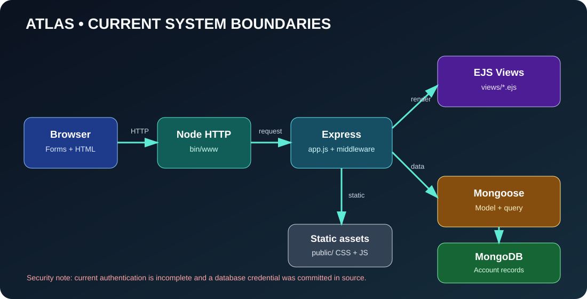
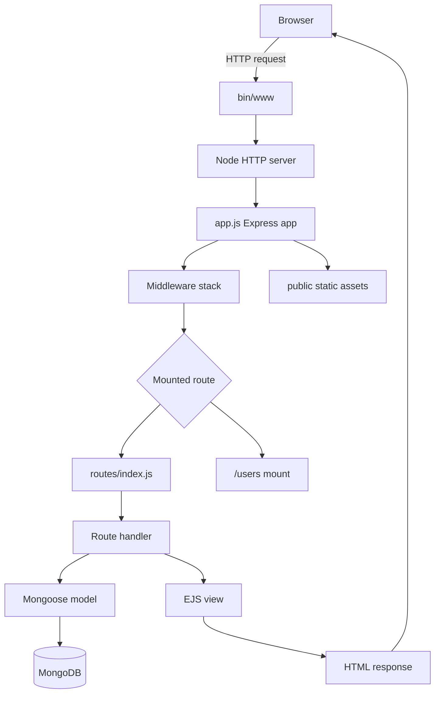
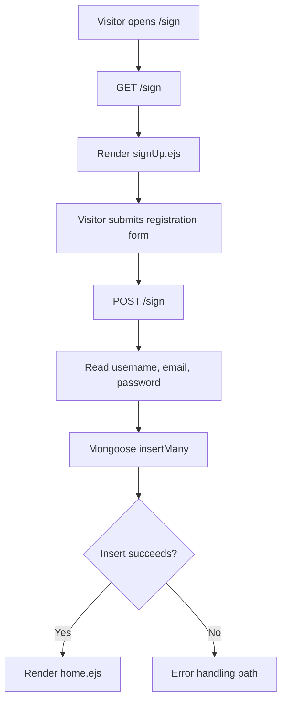
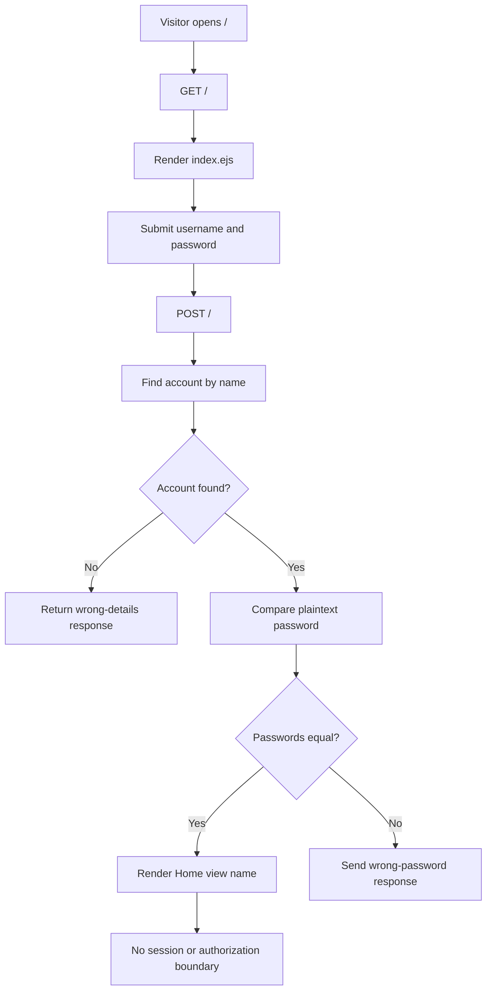
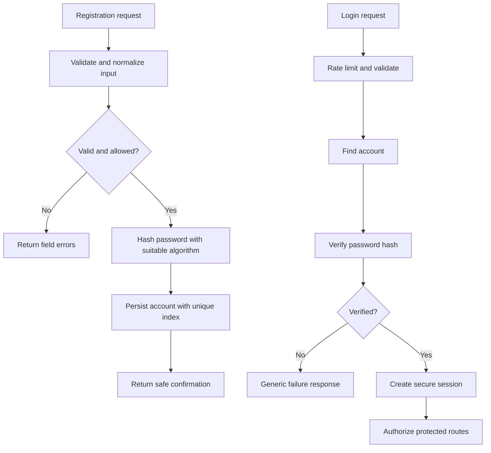

<p align="center">
  
</p>
<h1 align="center">🧭 Atlas</h1>
<p align="center"><strong>An Express.js, EJS, and MongoDB learning project for server-rendered account forms and a small demonstration site.</strong></p>
<p align="center">
  <a href="https://nodejs.org/"></a>
  <a href="https://expressjs.com/"></a>
  <a href="https://ejs.co/"></a>
  <a href="https://mongoosejs.com/"></a>
  <a href="LICENSE"></a>
</p>
<p align="center"><a href="#-overview">Overview</a> · <a href="#-features-and-status">Features</a> · <a href="#-architecture">Architecture</a> · <a href="#-run-locally">Run locally</a> · <a href="docs/README.md">Documentation</a></p>

---

> [!CAUTION]
> **Atlas is an educational prototype, not production-ready authentication software.** The inspected source currently stores passwords in plaintext, compares them directly, does not establish a durable authenticated session, and contains a MongoDB URI with embedded credentials in source control. Do not use real passwords or production data. Rotate the exposed database credential immediately and follow [SECURITY.md](SECURITY.md).

## 🧭 Overview

Atlas is a small Node.js web application using Express for HTTP routing, EJS for server-rendered pages, and Mongoose for MongoDB operations. It demonstrates a login form, a registration form, a route that inserts account data, and a Broadway-inspired destination page.

The repository follows the familiar Express generator layout: the HTTP server starts from `bin/www`, middleware and view configuration live in `app.js`, route handlers are in `routes/`, EJS templates are in `views/`, and browser assets are under `public/`.

The purpose of this repository is to explore the structure of a server-rendered Express application. It should not be presented as a secure account-management system until authentication, authorization, session handling, validation, secret management, and database access are redesigned and independently verified.

### Project facts

| Item | Current repository |
|---|---|
| Runtime | Node.js |
| Web framework | Express 4 |
| Template engine | EJS 2 |
| Database access | Mongoose 8 |
| Database | MongoDB |
| Static assets | `public/` |
| Server entry | `bin/www` |
| Express configuration | `app.js` |
| Main routes | `routes/index.js` |
| Account model/connection | `routes/users.js` |
| Start command | `npm start` |
| Default port | `3000` |
| Automated test suite | Not configured |
| Lint script | Not configured |

## 📚 Contents

- [Overview](#-overview)
- [Features and status](#-features-and-status)
- [Visual gallery](#-visual-gallery)
- [Application routes](#-application-routes)
- [Architecture](#-architecture)
- [Request and authentication flows](#-request-and-authentication-flows)
- [Technology stack](#-technology-stack)
- [Repository structure](#-repository-structure)
- [Run locally](#-run-locally)
- [Configuration](#-configuration)
- [Database model and data lifecycle](#-database-model-and-data-lifecycle)
- [Security and privacy](#-security-and-privacy)
- [Testing and quality](#-testing-and-quality)
- [Troubleshooting](#-troubleshooting)
- [Contributing and governance](#-contributing-and-governance)
- [Roadmap](#-roadmap)
- [Documentation map](#-documentation-map)
- [License](#-license)

## ✅ Features and status

The labels describe the checked-in behavior, not planned functionality.

| Capability | Status | Evidence / limitation |
|---|---|---|
| Express application setup | 🟢 Present | Middleware and views configured in `app.js` |
| EJS rendering | 🟢 Present | Templates under `views/` |
| Login form page | 🟢 Present | `GET /` renders `index.ejs` |
| Registration page | 🟢 Present | `GET /sign` renders `signUp.ejs` |
| Account insert | 🟡 Partial | `POST /sign` inserts name, email, password values |
| Login lookup | 🟡 Partial | `POST /` looks up name and compares plaintext password |
| MongoDB connection | 🟡 Present but unsafe | Connection URI is hard-coded in source |
| Session authentication | ❌ Not implemented | No durable login session or identity middleware |
| Route authorization | ❌ Not implemented | `GET /home` is not protected |
| Password hashing | ❌ Not implemented | Password is stored and compared as plaintext |
| Input validation | ⚠️ Incomplete | HTML required attributes are not server-side validation |
| Automated tests | ❌ Not configured | No test script or test suite in package manifest |
| Structured logging/monitoring | ❌ Not configured | Morgan development logger only |
| Newsletter behavior | ⚠️ Frontend mismatch | `public/javascripts/script.js` expects DOM elements not shown in the login template |

## 🖼️ Visual gallery

### Repository illustration

<p align="center">
  
</p>

### Browser screenshots

| Screen | Planned capture | Status |
|---|---|---|
| Login page | `docs/demo/login.png` | ⏳ Real browser capture pending |
| Sign-up page | `docs/demo/signup.png` | ⏳ Real browser capture pending |
| Home page | `docs/demo/home.png` | ⏳ Real browser capture pending |
| Error page | `docs/demo/error.png` | ⏳ Capture pending, template currently absent |

The SVG above is a technical illustration, not a screenshot. Genuine UI captures must come from running the application. See [Demo and screenshot policy](docs/demo/README.md).

## 🗺️ Application routes

Routes below are taken from `routes/index.js`. The application mounts that router at `/`.

| Method | Path | Handler | Current result |
|---|---|---|---|
| GET | `/` | `router.get('/')` | Renders `index.ejs` |
| POST | `/` | `router.post('/')` | Looks up name and compares password |
| GET | `/sign` | `router.get('/sign')` | Renders `signUp.ejs` |
| POST | `/sign` | `router.post('/sign')` | Inserts submitted account object, renders home |
| GET | `/home` | `router.get('/home')` | Renders `home.ejs` |
| GET | `/users` | Generated users router | Router is mounted, but `routes/users.js` exports the Mongoose model rather than an Express router |

**Important:** a successful POST to `/` is not a secure authenticated session. The current `/home` route can be requested directly. This is an implementation gap, not a feature.

See [HTTP route reference](docs/routes.md).

## 🏗️ Architecture

Atlas is a single-process Node.js web application. Express handles HTTP middleware and routing, EJS renders HTML on the server, and Mongoose provides MongoDB model/connection behavior.

**Current request path**



> **Diagram note:** this shows the intended high-level wiring visible in the Express setup. The `/users` mount is currently misconfigured because `routes/users.js` exports a Mongoose model rather than an Express router. It is shown to make the configured mount visible, not to imply that it is a functioning route module.

### Main responsibilities

| Layer | Files | Responsibility |
|---|---|---|
| HTTP startup | `bin/www` | Reads port, creates HTTP server, handles listen errors |
| Express app | `app.js` | Middleware, static assets, views, routes, error handling |
| Route handlers | `routes/index.js` | Login/register form handling and page rendering |
| Data connection/model | `routes/users.js` | Mongoose connection and account schema |
| Templates | `views/*.ejs` | HTML documents and form screens |
| Static assets | `public/` | Browser CSS and JavaScript |
| Configuration | `.env.example`, package files | Environment example and dependency manifest |

See [Architecture](docs/architecture.md), [System design](docs/system-design.md), and [Data flow](docs/data-flow.md).

## 🔄 Request and authentication flows

### Registration, current implementation



The form and handler currently do not implement password hashing, unique-account checks, server-side input validation, or an authenticated session.

### Login, current implementation



The current code renders `Home` with an uppercase view name on the successful login branch, while registration renders lowercase `home`. The filesystem contains `views/home.ejs`, so the login success path should be tested and corrected in a separate application fix.

### Recommended secure authentication flow



This is a target design only. It is not implemented in the repository.

## 🧰 Technology stack

| Technology | Current usage |
|---|---|
| Node.js | Server runtime |
| Express 4 | HTTP framework and routing |
| EJS 2 | Server-side HTML templates |
| Mongoose 8 | MongoDB ODM and schema/model |
| MongoDB | Account data storage |
| Morgan | Development HTTP request logging |
| cookie-parser | Cookie parsing middleware |
| http-errors | HTTP error creation |
| debug | Server debug namespace |

The declared dependencies and exact versions are defined by `package.json` and resolved by `package-lock.json`. See [Dependency review](docs/dependencies.md).

## 🗂️ Repository structure

```text
Atlas/
├── .github/
│   ├── ISSUE_TEMPLATE/          # Structured issue forms
│   ├── workflows/               # CI and maintenance automation
│   └── PULL_REQUEST_TEMPLATE.md
├── bin/
│   └── www                       # HTTP server startup
├── docs/
│   ├── adr/                      # Architecture decision records
│   ├── assets/                   # Source-controlled SVG illustrations
│   ├── demo/                     # Browser screenshot capture guide
│   ├── diagrams/                 # Mermaid diagrams
│   └── *.md                      # Product, engineering and ops docs
├── public/
│   ├── javascripts/script.js     # Browser behavior
│   └── stylesheets/style.css    # Login page styles
├── routes/
│   ├── index.js                  # Form routes and persistence calls
│   └── users.js                  # Mongoose connection/model
├── views/
│   ├── home.ejs                  # Demonstration destination page
│   ├── index.ejs                 # Login page
│   └── signUp.ejs                # Sign-up form
├── app.js                        # Express app and middleware
├── package.json
├── package-lock.json
└── .env.example                  # Safe local configuration example
```

The repository also contains IDE metadata under `.idea/`. See [Project structure](docs/project-structure.md) for the role of each source file and the current routing caveats.

## 🚀 Run locally

### Prerequisites

- Node.js 18 or newer.
- npm.
- A MongoDB instance reachable from the development machine.
- Git.

### Clone and install

```bash
git clone https://github.com/Brajesh31/Atlas.git
cd Atlas
npm ci
```

For the first install, `npm install` is also available. Prefer `npm ci` for repeatable installs from the committed lockfile.

### Configure the environment

Create an untracked `.env` file based on `.env.example` and provide local settings. **The current source does not load dotenv and does not yet read `MONGODB_URI`**, so adding values to the file alone does not reconfigure the existing Mongo connection. The hard-coded connection must be moved to environment configuration in a source-code security fix before using a real database.

Use only a disposable local database and fake test credentials. Do not use real accounts or personal information.

### Start

```bash
npm start
```

The HTTP server defaults to port 3000. Set `PORT` in the process environment to use another port. Open <http://localhost:3000>.

### Available scripts

| Command | Purpose |
|---|---|
| `npm start` | Starts `node ./bin/www` |
| `npm ci` | Installs dependencies from the lockfile |
| `npm install` | Resolves and installs dependencies |

There are no configured lint, test, build, or development-watch scripts in the current package manifest.

## ⚙️ Configuration

The committed `.env.example` documents `PORT` and `MONGODB_URI`, but the application currently reads `PORT` in `bin/www` and uses a hard-coded MongoDB URI in `routes/users.js`. This mismatch is documented as a security defect.

Never place secrets in source files, issue reports, screenshots, or documentation. Rotate the database password that has been exposed in the repository, remove the hard-coded value in a dedicated source change, and configure the replacement through a proper secret mechanism. See [Configuration](docs/configuration.md) and [Security review](docs/security-review.md).

## 🗄️ Database model and data lifecycle

The Mongoose schema currently defines:

| Field | Type | Required |
|---|---|---|
| `name` | String | Yes |
| `password` | String | Yes |

The registration handler also submits an `email` value, but the current schema does not declare it. The schema does not define a unique index on account name or email, timestamps, password hashing, or explicit validation beyond required fields.

See [Database design](docs/database.md).

## 🔐 Security and privacy

Current high-priority concerns:
1. A MongoDB credential is embedded in source code and has been committed.
2. Passwords are inserted and compared in plaintext.
3. Login does not establish a durable session.
4. The `/home` route is not protected by authentication middleware.
5. Account registration has no demonstrated server-side validation or uniqueness enforcement.
6. Error responses distinguish some account/password outcomes.
7. `app.js` configures an error handler that renders an `error` view, but no `views/error.ejs` file is present in the repository tree.
8. The sign-up EJS template contains multiple forms and the primary visible registration form needs to be checked against the server route contract.

Do not expose this app to the public internet in its current state. Follow [SECURITY.md](SECURITY.md), [Threat model](docs/security-review.md), and [Data handling](docs/data-privacy.md).

## 🧪 Testing and quality

There is currently no automated test framework, test folder, lint script, or CI validation workflow for the application. The only workflow in the original repository updates the README timestamp, including on a scheduled trigger.

A minimum manual test pass should cover:
- GET / renders the login page.
- GET /sign renders the sign-up page.
- POST /sign with valid disposable input.
- POST /sign with missing/invalid fields.
- POST / with valid and invalid credentials.
- POST / with an unknown username.
- Direct GET /home without login.
- MongoDB unavailable at startup and during a request.
- Unknown route and error-handler behavior.
- Static CSS and JavaScript requests.

See [QA plan](docs/qa.md) and [Testing strategy](docs/testing-strategy.md).

## 🧰 Troubleshooting

| Symptom | Likely cause | First check |
|---|---|---|
| Server fails to start | Port occupied or Node dependency issue | Check Node version and PORT |
| MongoDB does not connect | URI, network access, credentials, or cluster policy | Inspect sanitized server logs and MongoDB network rules |
| Sign-up fails | Database unavailable, schema/handler mismatch, or duplicate data | Inspect request and model validation errors |
| Login returns wrong details | Account lookup failed or data differs | Use a disposable local test account |
| Login reports successful but home fails | Case mismatch between `Home` and `home` view name | Inspect route render target and view filename |
| CSS is missing | Static asset path or server root | Check /stylesheets/style.css |
| Unknown route causes another error | Error view missing | Confirm views/error.ejs exists before relying on the handler |
| Environment variable has no effect | Source does not read the variable | Check config implementation rather than .env alone |

More detail: [Troubleshooting guide](docs/troubleshooting.md).

## 🤝 Contributing and governance

- [Contributing guide](CONTRIBUTING.md)
- [Code of Conduct](CODE_OF_CONDUCT.md)
- [Security policy](SECURITY.md)
- [Support guide](SUPPORT.md)
- [Code owners](CODEOWNERS)
- [Changelog](CHANGELOG.md)
- [Roadmap](ROADMAP.md)
- [Citation metadata](CITATION.cff)

Do not submit real credentials, account data, or private database exports. Security-sensitive changes need explicit review and tests.

## 🗺️ Roadmap

The highest-priority work is security and correctness, not adding visual complexity:
- Rotate the exposed MongoDB credential.
- Remove source-level database credentials and wire environment configuration.
- Hash passwords and implement safe verification.
- Add server-side validation and unique account constraints.
- Implement session management and protect private routes.
- Fix route/view mismatches and missing error template.
- Add automated route/model tests and CI.
- Improve responsive and accessible form behavior.
- Add structured logs and deployment health checks.

See [ROADMAP.md](ROADMAP.md). Planned work is not current functionality.

## 📚 Documentation map

| Topic | Document |
|---|---|
| Documentation hub | [docs/README.md](docs/README.md) |
| Product brief | [docs/product-brief.md](docs/product-brief.md) |
| Architecture | [docs/architecture.md](docs/architecture.md) |
| Request/data flow | [docs/data-flow.md](docs/data-flow.md) |
| Route contract | [docs/routes.md](docs/routes.md) |
| HTTP behavior | [docs/api.md](docs/api.md) |
| Database model | [docs/database.md](docs/database.md) |
| Configuration | [docs/configuration.md](docs/configuration.md) |
| Security review | [docs/security-review.md](docs/security-review.md) |
| Data privacy | [docs/data-privacy.md](docs/data-privacy.md) |
| Deployment | [docs/deployment.md](docs/deployment.md) |
| QA and testing | [docs/qa.md](docs/qa.md), [docs/testing-strategy.md](docs/testing-strategy.md) |
| Operations | [docs/operations.md](docs/operations.md) |
| Threats and risks | [docs/risk-register.md](docs/risk-register.md) |
| Visual diagrams | [docs/diagrams/README.md](docs/diagrams/README.md) |
| Demo captures | [docs/demo/README.md](docs/demo/README.md) |

## 📄 License

Atlas is released under the MIT License. See [LICENSE](LICENSE). Third-party packages, fonts, images, and remote resources remain subject to their respective licenses and terms.

<p align="center"><sub>README reflects the inspected source and calls out known gaps. Last reviewed: 2026-11-16.</sub></p>

Last updated: 2026-11-21 05:20 UTC
