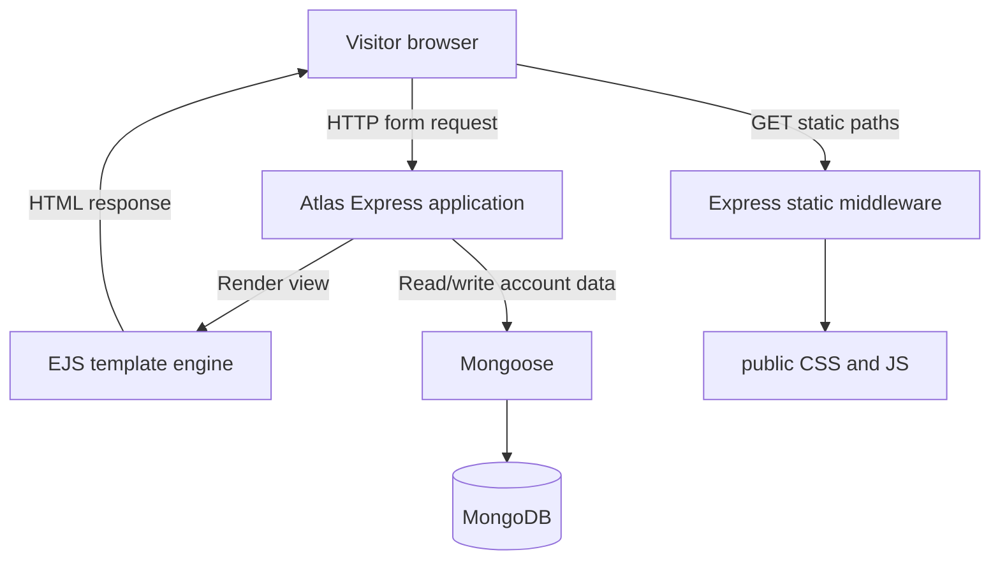

# 🏗️ Atlas application architecture

## 1. Context
Atlas is a Node.js application that renders HTML on the server. Express accepts requests and routes them to handlers. EJS converts templates into HTML responses. Mongoose manages the MongoDB model and connection.

There is no API gateway, separate application backend, queue, cache, frontend SPA, session provider, or identity service in the current repository.

## 2. System context

## 3. Bootstrap sequence
1. npm start runs node ./bin/www.
2. bin/www imports app.js and reads PORT.
3. A Node HTTP server is created from the Express app.
4. app.js configures EJS and middleware.
5. The public directory is exposed through static middleware.
6. The root and users routers are mounted.
7. 404 and error handlers are registered.
8. The server begins listening.

## 4. Middleware order

| Order | Middleware | Purpose |
|---|---|---|
| 1 | Morgan dev logger | Request logging in development format |
| 2 | express.json | Parse JSON request bodies |
| 3 | express.urlencoded | Parse URL-encoded form data |
| 4 | cookieParser | Parse Cookie request header |
| 5 | express.static | Serve public assets |
| 6 | Root router | Login, registration, home routes |
| 7 | Users mount | Current mount receives an exported Mongoose model, not an Express router |
| 8 | 404 handler | Creates HTTP 404 error |
| 9 | Error handler | Sets response locals and renders an error view |

The users mount is a structural defect: routes/users.js exports a Mongoose model rather than an Express router. The mount should be reviewed in a source-code fix, not hidden by documentation.

## 5. Layer responsibilities

| Layer | Implementation | Responsibility |
|---|---|---|
| Server startup | bin/www | Port normalization and HTTP server lifecycle |
| App composition | app.js | Middleware, static path, views and routers |
| HTTP route handlers | routes/index.js | Login, registration and view rendering |
| Data access | routes/users.js | Mongoose schema/model and connection |
| Presentation | views/*.ejs | Server-rendered user pages |
| Browser assets | public/* | CSS and JavaScript |
| Runtime configuration | process environment | PORT currently used; Mongo URI not yet wired |

## 6. Current state and trust boundaries
The browser submits form fields to Express. Express parses the body and route code reads username, email, and password. The route module invokes Mongoose. MongoDB returns a model/document or error. The handler renders a template or sends a text message.

Every form field is untrusted input. Every database record is sensitive. The current plaintext password design and source-level database credential are unacceptable for a public deployment.

## 7. Failure boundaries
- Startup: invalid port, occupied port, missing packages.
- Middleware: malformed or oversized request body.
- Routing: incorrect route or invalid mount target.
- View rendering: missing template or view-name case mismatch.
- Database: DNS, credentials, access list, network, cluster status.
- Authentication: missing record, wrong password, malformed record.
- Static content: wrong path or missing file.

## 8. Recommended target architecture
A production-oriented refactor should separate route handlers, validation, password service, session/authorization middleware, database model, configuration, and view rendering. Only introduce abstraction where there is a concrete testability or security benefit.

## 9. Architecture decision process
Record decisions as ADRs with context, decision, alternatives, consequences, and status. Do not document a proposed layer as existing code until a matching source implementation is merged.
