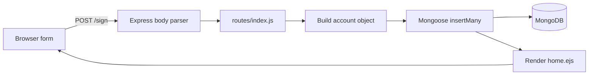
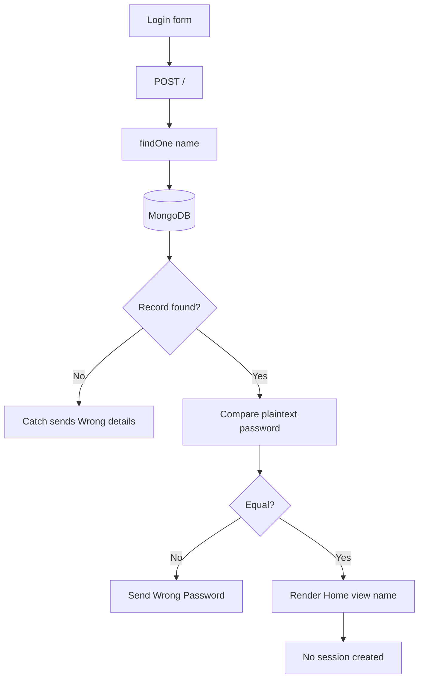

# 🔄 Request and data flow

## Current registration data flow
A browser loads the sign-up page, submits form fields, Express parses the request body, the route builds an object, Mongoose inserts it, and Express renders the home view.

## Current login data flow
The login form posts username and password. The route queries MongoDB by name and performs a direct string comparison on the stored password field.

## Current data fields
The handler reads username, email, and password. The model declares name and password. The email field is therefore part of the route input but not the current explicit schema.

## Data lifetime
Account data is persisted in MongoDB. Request body values exist transiently in memory during the request. No user session or authentication state is persisted by the current code.

## Sensitive data
The current code stores a raw password. This is a critical issue. Never put raw passwords in logs, screenshots, fixtures, support requests, or documentation. Any real password already stored in a database used by this app should be considered exposed and rotated.

## Target secure flow
A future data flow should normalize and validate the identifier, hash the password before insert, enforce uniqueness in MongoDB, verify the hash during login, create a secure session, and authorize each protected route. The browser should never receive password hashes or database credentials.
