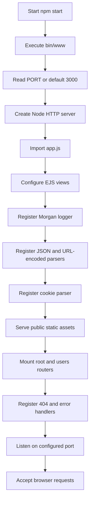
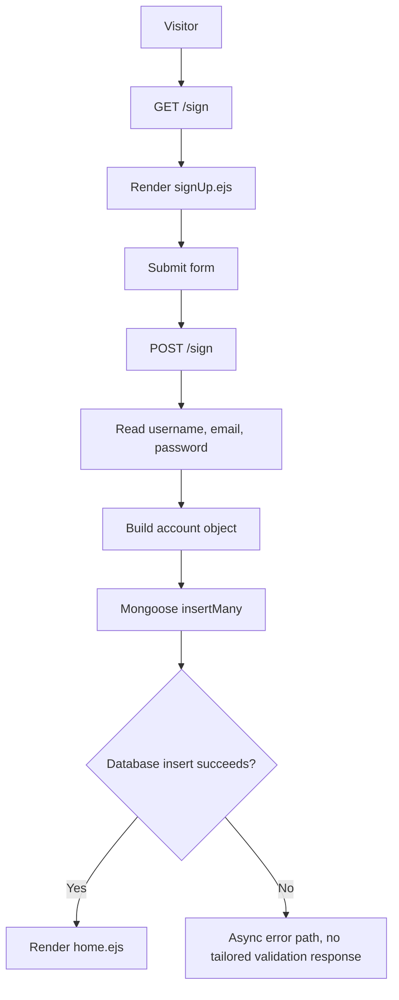
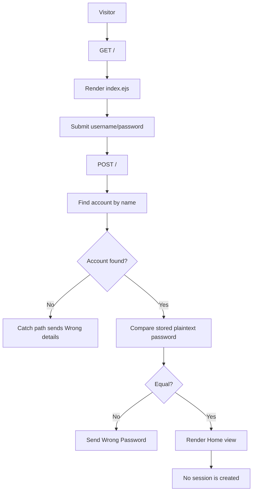
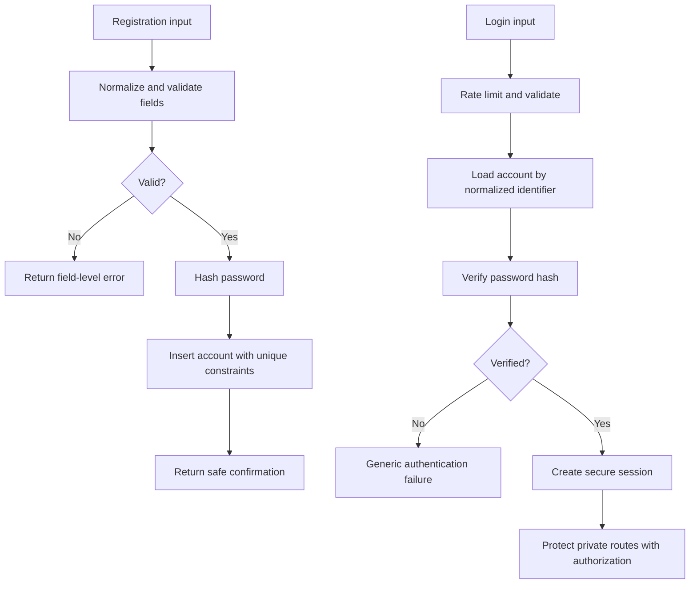
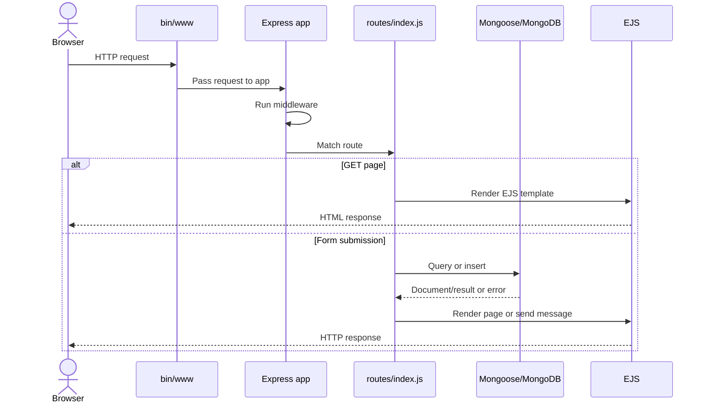
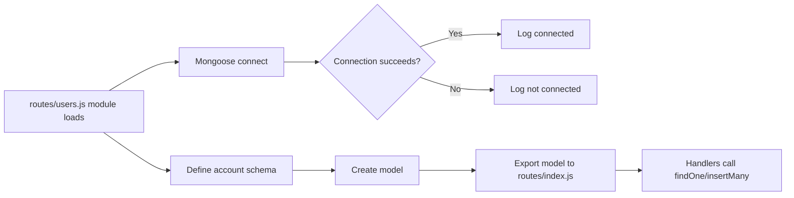
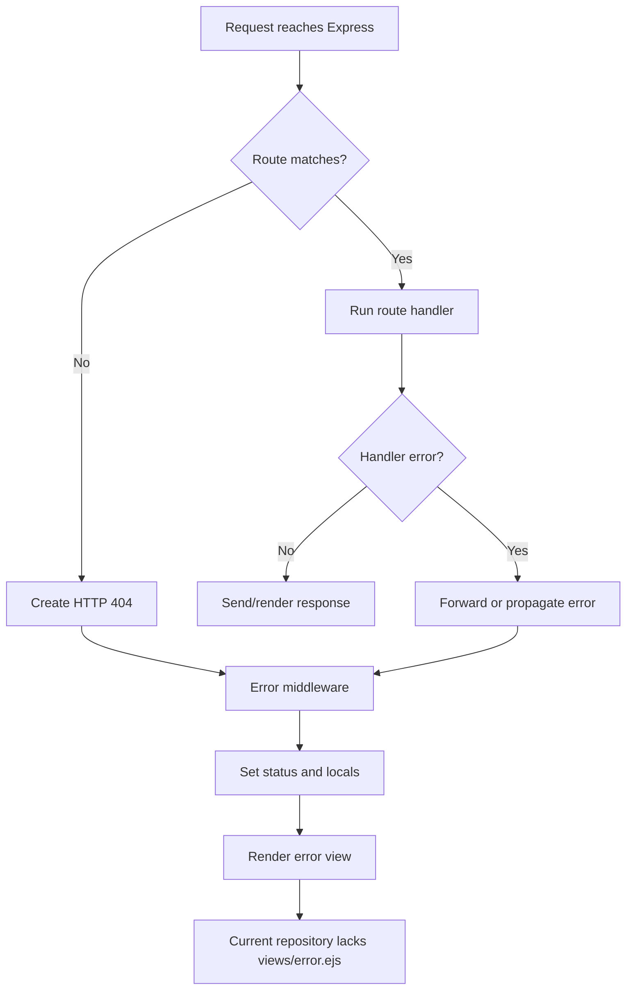
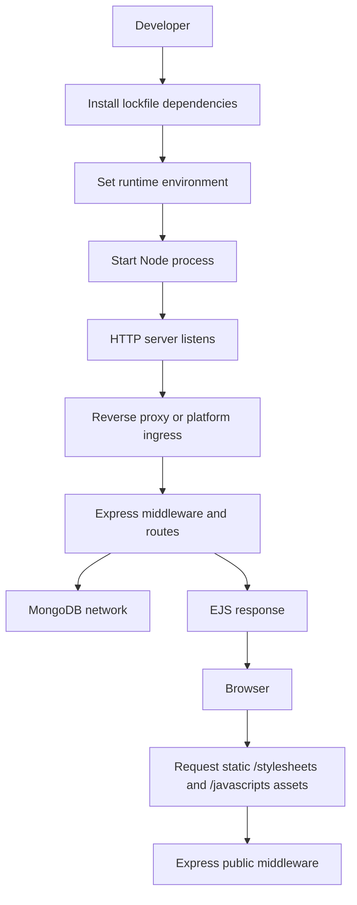
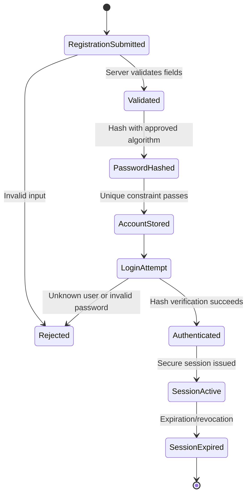

# 🔀 Atlas flowcharts and sequence diagrams

These diagrams document the existing Express application. Diagrams explicitly marked **target** or **recommended** are not implemented behavior.

## 1. Server startup and middleware

## 2. Registration, current implementation

## 3. Login, current implementation

## 4. Recommended secure registration and login

This is a target architecture only. The current app does not implement this flow.

## 5. Request lifecycle and Express routing

## 6. Current database connection path

The current source includes a database credential in the connection URI. It must be rotated and removed from source control.

## 7. Error path

## 8. Deployment request path

## 9. Proposed account data lifecycle

This is a future design model, not a current persistence or session implementation.
