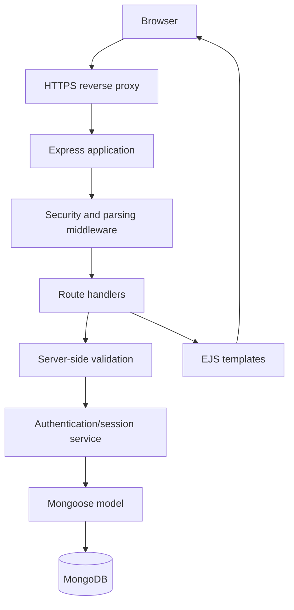

# 🧠 System design and secure evolution

## Current design
Atlas is a single Express application with EJS rendering and direct Mongoose access from route code. The app uses middleware for logging, request parsing, cookies, and static files. It has no session store, authorization middleware, or separate service layer.

## Current-to-target responsibility map

| Concern | Current | Secure target |
|---|---|---|
| HTTP server | bin/www | Retain with explicit shutdown handling |
| Middleware | app.js | Add security headers, CSRF, rate limits, body limits |
| Routing | routes/index.js | Separate auth and page route modules |
| Data access | routes/users.js model export | Explicit model module and repository/service boundary |
| Passwords | Plaintext | Password hash and constant-time verification as supported by library |
| Sessions | None | Secure, HttpOnly, SameSite cookies and session store |
| Authorization | None | Middleware protects private routes |
| Validation | HTML-only constraints | Server-side schema validation |
| Errors | Generic/mixed text and missing error view | Centralized safe error responses |
| Tests | None | Unit, HTTP integration, database, browser |

## Target request architecture

## Security evolution order
1. Revoke and rotate the exposed MongoDB credential.
2. Read connection URI from managed environment configuration.
3. Hash existing/new passwords safely; plan invalidation/reset for any plaintext accounts.
4. Add server-side input validation and unique indexes.
5. Add session lifecycle and protected routes.
6. Add CSRF, rate limiting, secure cookie policy, and headers.
7. Add tests for authentication and authorization.
8. Add safe error pages and operational controls.

## Avoid premature complexity
Do not introduce microservices, queues, caches, or an SPA frontend without a concrete requirement. The most valuable immediate work is fixing correctness and security in the existing app.
