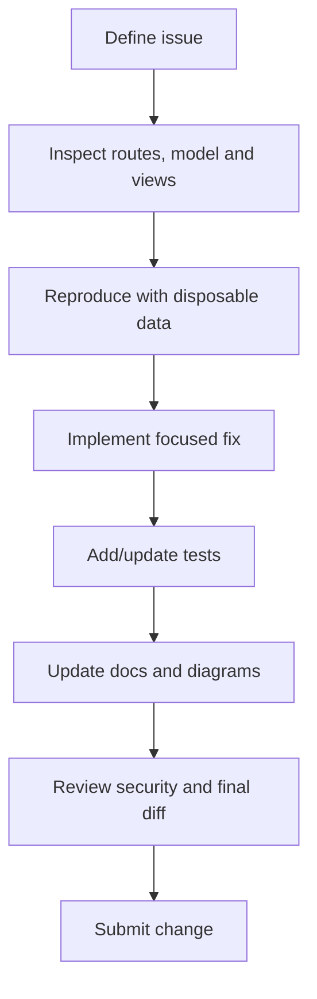

# 🔁 Contributor workflow

## 1. Select a focused change
Describe the issue, affected route, expected result, and non-goals. Security issues should be reported privately under SECURITY.md.

## 2. Inspect the source
- Review app.js middleware order.
- Review routes/index.js handler and field names.
- Review routes/users.js schema and database setup.
- Review related EJS templates.
- Review static CSS/JavaScript dependencies.
- Check docs/routes.md and risk-register.md.

## 3. Reproduce safely
Use a disposable local database and synthetic user. Never use real passwords or the committed database credential. Capture sanitized status/error evidence.

## 4. Implement and test
Keep source changes focused. Add tests for validation, model behavior, auth, sessions, and protected routes as appropriate. Do not combine major architecture changes with unrelated documentation edits.

## 5. Update docs and visuals
Update route contracts, data-flow diagrams, architecture, security risks, README feature status, and changelog. Capture a genuine browser screenshot only after verifying the route.

## 6. Review
Confirm no secrets, personal records, or generated artifacts were included. Verify template names and form field contracts. Check the final diff for accidental file deletion.

## Workflow diagram

## Completion standard
A task is complete only when source behavior matches its documentation, tests have been run, existing files are preserved unless explicitly changed, and unresolved risks are reported honestly.
